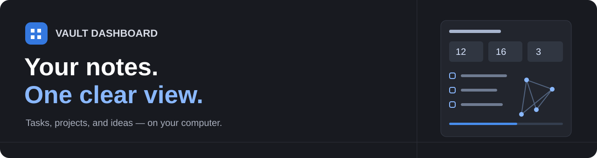
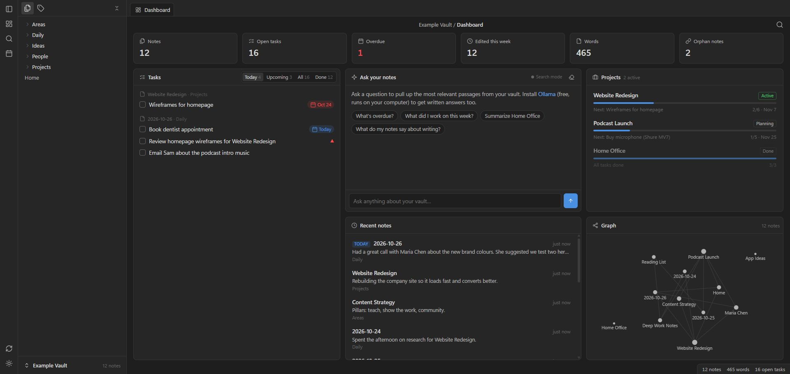
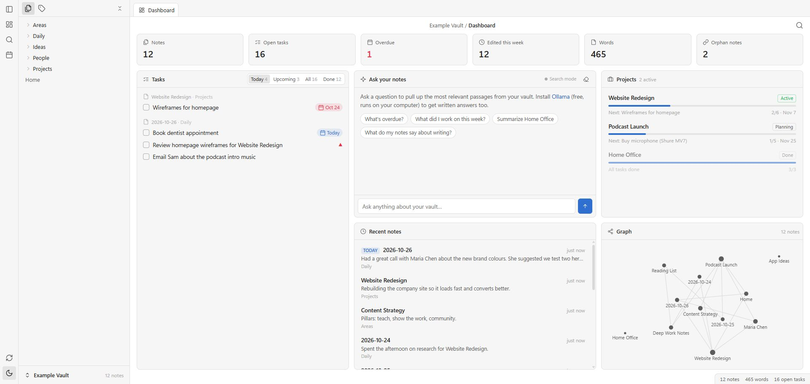

<p align="center">
  
</p>

<p align="center">
  <strong>See your Obsidian notes, tasks, and projects in one place.</strong><br>
  Free to use. Runs on your computer. No account needed.
</p>

<p align="center">
  
  
  
  
</p>

<p align="center">
  <a href="#try-it-with-sample-notes">Try it</a> ·
  <a href="#what-can-it-do">Features</a> ·
  <a href="#use-your-own-vault">Your vault</a> ·
  <a href="#add-ai-answers-if-you-want">AI answers</a>
</p>



*The notes and people in these pictures are demo content from the sample vault.*

## What is this?

An Obsidian **vault** is a folder that holds your notes.

Vault Dashboard reads that folder and shows a home screen in your web browser.
See what needs doing, find a note, and follow links between ideas.
Your notes stay in their folder.

This is a separate browser app. It is not an Obsidian plugin. It does not
change what Obsidian opens at startup.

## What can it do?

| Part | What you can do |
| --- | --- |
| **Tasks** | Find checkboxes across your notes. Show today, upcoming, all, or done tasks. |
| **Projects** | See a project's status, next task, due date, and progress. |
| **Recent notes** | Jump to notes you changed lately. Today's daily note stays at the top. |
| **Search** | Find a note by its name, words, or a `#tag`. |
| **Link graph** | See a map of how your notes connect. Click a dot to open a note. |
| **Note reader** | Read notes with tables, images, callouts, and links back to them. |
| **Ask your notes** | Find useful parts of your notes. Add Ollama for written AI answers. |
| **Stats** | See note and word counts, open tasks, and notes with no links. |

**Checking a task changes the checkbox in the original note.**
For tasks that use Tasks-plugin marks, it can also add or remove a done date.

## Try it with sample notes

You need [Python 3.9 or newer](https://www.python.org/downloads/).
There are no extra Python packages to install.

1. Click the green **Code** button on this page, then **Download ZIP**.
2. Unzip the download.
3. Open a terminal in the folder with `vault_dashboard.py`.
4. Run this on Windows:

   ```sh
   python vault_dashboard.py "Example Vault"
   ```

   On Mac or Linux, use:

   ```sh
   python3 vault_dashboard.py "Example Vault"
   ```

Your browser opens the dashboard. The sample vault has 12 notes to explore.
Its dates are fixed, so the Today and Overdue counts change over time.

**To stop it:** press `Ctrl+C` in the terminal.

## Use your own vault

Replace `path/to/your/vault` with your vault folder. Keep the quotes if the path
has spaces.

```sh
python vault_dashboard.py "path/to/your/vault"
```

On Mac or Linux, use `python3` in place of `python`.

You can also run it with no path:

```sh
python vault_dashboard.py
```

It looks for vaults saved in Obsidian. If it finds more than one, it asks which
one to use.

**Double-click launchers:** use `Start Dashboard.bat` on Windows or
`Start Dashboard.command` on Mac. Python must be installed first. On Mac,
you may need to run `chmod +x "Start Dashboard.command"` once.

Keep `dashboard.html` and `vault_dashboard.py` in the same folder.
Keep this app's folder outside your own vault so app files stay out of your notes.

## Light or dark? Pick either.

Click the sun or moon button on the left to switch looks.



## Add AI answers if you want

The app works without AI. **Search mode** finds matching parts of your notes.
For written answers, use [Ollama](https://ollama.com).

1. Install Ollama and keep it running.
2. Download a model:

   ```sh
   ollama pull llama3.2
   ```

3. Restart Vault Dashboard.

The Ask panel shows the model when it is ready. The model download needs the
internet. After that, a local model can answer on your computer.
AI can get things wrong. Check the source notes.

To pick a different model:

```sh
python vault_dashboard.py "path/to/your/vault" --model qwen2.5
```

## Your files and privacy

- The dashboard listens only on `127.0.0.1`, which means this computer.
- It does not need a login or a cloud service.
- It reads notes from the folder you choose.
- Its only note edit is a task toggle, with a done date when needed.
- Before a task edit, it checks that the task line still matches.
- With the default settings, AI requests go to Ollama on this computer.
- If you set `--ollama-url` to another computer, note excerpts can go there.

Try the sample vault first. Keep a backup of notes that matter to you.
Do not put private notes in this public code folder.

## Help it find projects and dates

A note counts as a project if it has `#project`, has `type: project` in its
properties, or sits right inside a `Projects` folder.

```markdown
---
type: project
status: active
due: 2026-11-07
---
# My project
- [x] Make a plan
- [ ] Build the first version 📅 2026-11-07
```

It reads Tasks-plugin date marks such as `📅` and `⏳`, plus dates written as
`[due:: 2026-11-07]`. A daily note's name should start with `YYYY-MM-DD`.

The app checks for changes about every 15 seconds and when you return to its tab.

## Handy keys

| Key | What it does |
| --- | --- |
| `Ctrl+O` / `Cmd+O` or `/` | Open search |
| `Esc` | Close the open search or overlay |
| `Ctrl+W` / `Cmd+W` | Close an open note tab in the app |

Type `#project` in search to find notes with that tag.

## Need help?

| Problem | Try this |
| --- | --- |
| Python is not found | Install Python. On Windows, try `py` in place of `python`. |
| The browser did not open | Open the address printed in the terminal. It is often `http://127.0.0.1:8765`. |
| The wrong vault opened | Run the app with the full path to the right vault. |
| AI is in Search mode | Check that Ollama is running and has a model. Restart the dashboard. |
| The app stopped after a restart | Start the Python app again. It does not run at computer startup by itself. |

## More options

```text
python vault_dashboard.py [vault] [--port 8765] [--model llama3.2]
                        [--ollama-url http://127.0.0.1:11434] [--no-browser]
```

`--port` picks the starting port. If it is busy, the app tries nearby ports.
`--no-browser` starts the app without opening a browser tab.

## License

Free to use and change under the [MIT License](LICENSE).
Icons are from [Lucide](https://lucide.dev) under the ISC license.
This is an independent project. It is not made by Obsidian.
